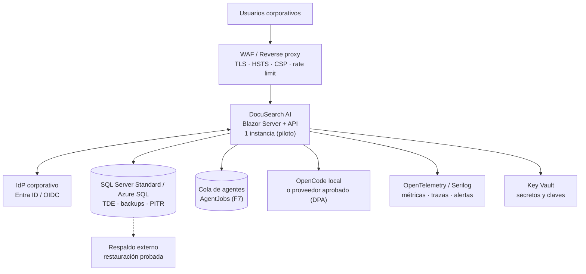

# De demo a aplicación real — hoja de ruta de producción para DocuSearch AI

**Fecha:** 12/11/2026 · **Base:** commit `8029295` y código actual · **Pregunta:** ¿qué hay que hacer **antes** de implementar multiagentes?
**Documento relacionado:** [`MULTIAGENTES-ANALISIS.md`](MULTIAGENTES-ANALISIS.md).
**Progreso de código (13/11/2026):** ya se aplicó el endurecimiento que no depende de infraestructura: guarda de producción, rate limiting de login, `/enroll` solo loopback, auditoría de `LOGIN_FAILED`/`LOGOUT`, cabeceras y cookies, sondas de salud, bloqueo de reset/seed y plantilla `appsettings.Production.example.json`. Verificado con **87/87** comprobaciones base y **10/10 del Agente Verificador AG-02** (`--verifier`). Detalle y pendientes en [`PRODUCCION-CAMBIOS.md`](PRODUCCION-CAMBIOS.md). Siguen bloqueando IdP, SQL Standard/backups, TLS/proxy, observabilidad, retención y gobierno de IA.

---

## 0. Veredicto ejecutivo

La aplicación es una **demo funcional muy completa**, pero no es una aplicación de producción. Los tres bloqueos de fondo no son de interfaz ni de IA:

1. **Identidad:** los usuarios viven en `Auth:Users` y los secretos TOTP en configuración externa (user-secrets/variables), no en un IdP; el inicio de sesión sincroniza y **sobrescribe** los datos del usuario en cada login (`Services/AuthService.cs:115-158`); `/enroll` muestra secretos en loopback si se habilita; no hay recuperación de cuenta ni revocación de sesión. **No es un sistema de identidad.** *Mitigado en código: /enroll solo loopback, rate limit y auditoría de intentos.*
2. **Datos:** SQL Server **Express** tiene un techo de 10 GB por base, los PDF viven en `varbinary(max)` y las cuotas configuradas suman 71 680 MB; no hay respaldo, restauración probada, retención ni cifrado en reposo declarado.
3. **Operación:** no hay CSP activa, despliegue, logs estructurados, métricas, alertas ni respaldos; la app es de un solo proceso y un solo host. *Mitigado en código: rate limiting de login (por instancia/IP), cabeceras, cookies seguras con HTTPS y sondas `/health/live` y `/health/ready`.*

**Consecuencia para multiagente:** la plataforma multiagente (cola, workers, aprobaciones, presupuesto) **no debe empezar** hasta cerrar identidad, datos y operación. La única excepción es el **Agente Verificador (AG-02)**: es determinista, no toca datos, no usa LLM y se puede implementar ya (1–2 días).

**Esfuerzo realista hacia un piloto interno controlado:** **8–12 semanas** con un desarrollador a tiempo completo usando servicios gestionados (IdP + SQL gestionado + observabilidad). A medio tiempo: **4–5 meses**. Un “demo con login real” en 2 semanas no es producción.

---

## 1. Qué significa “real” (alcance y supuestos)

| Nivel | Supuesto | Qué exige |
|---|---|---|
| **Piloto interno** | 20–100 usuarios, ≤ 50 000 documentos, una organización, sin alta disponibilidad | Identidad corporativa, TLS, respaldos probados, retención, logs/alertas, política de IA. |
| **Producción interna** | 100–1 000 usuarios, datos sensibles, SLA | Todo lo anterior + HA, DR, WORM/SIEM, pen test, revisiones de acceso, soporte. |
| **Enterprise** | Multisede, auditoría externa, ISO/SOC | Gobierno, segregación de funciones, certificaciones, DLP, cumplimiento formal. |

Este documento apunta al **piloto interno** y marca qué falta para producción interna. Supuestos: una sola organización, documentos corporativos con los cuatro niveles actuales y despliegue Windows/SQL Server o Azure.

---

## 2. Diagnóstico: marcadores de demo (con evidencia)

| Área | Estado actual | Evidencia | Riesgo | ¿Bloquea producción? |
|---|---|---|---|---|
| Identidad | 3 usuarios en `Auth:Users`; cada login crea/actualiza el usuario y **sobrescribe** rol, nombre, departamento y estado | `Services/AuthService.cs:115-158` | Un admin no puede gestionar usuarios de verdad; cambios se pierden | **Sí** |
| Segundo factor | Correo + TOTP (identificador + algo que tienes); sin contraseña, passkey ni IdP | `AuthService.cs:76-109`; `Program.cs:179-219` | No es MFA real ni identidad federada; sin recuperación | **Sí** |
| Alta de dispositivos | `/enroll` es ruta pública y muestra **todos** los secretos/QR si se habilita | `Program.cs:163-166`, `:230-247`; `AuthService.cs:236-286` | Exposición total de secretos en red | **Sí** |
| Fuerza bruta | Sin rate limit ni bloqueo de cuenta; solo logs de aviso | `Program.cs` (sin `AddRateLimiter`); `AuthService.cs:81-102` | Prueba de códigos TOTP sin fricción | **Sí** |
| Sesión | Cookie 8 h deslizante, `SameSite=Lax`, `SecurePolicy=SameAsRequest` | `Program.cs:31-43` | Sin revocación inmediata ni `Secure` garantizado | Sí |
| Perímetro | `Demo:LocalOnly=true`; sin TLS, HSTS, CSP ni cabeceras de proxy | `Program.cs:97-140`; `appsettings.json:39-47` | No puede salir del host | **Sí** |
| Hosts | `AllowedHosts` solo localhost | `appsettings.json:6` | Dominio real rechazado | Sí |
| Datos | SQL Server Express, 10 GB/base, 1 GB RAM, 4 núcleos | `appsettings.json:9`; `README.md:42-51`, `:205-208` | Techo de capacidad y rendimiento | **Sí** |
| Respaldos | No hay estrategia ni restauración probada; los PDF están en la base | `AppDbContext.cs:37`; `README.md:668-670` | Pérdida total ante fallo | **Sí** |
| Retención | Sin política ni borrado programado; trazas sin retención | `README.md:472-474` | Crecimiento y cumplimiento | **Sí** |
| Auditoría | Append-only desde la app; un DBA puede modificarla; sin SIEM | `README.md:566-567` | No es evidencia forense | Producción interna |
| Datos demo | Seed de 5 expedientes y `ResetAsync("RESTABLECER")` accesible en Administración | `Data/DatabaseSetup.cs:22-34`; `DocumentService.cs:322-346`; `Administration.razor:63-70` | Borrado accidental o datos falsos | **Sí** |
| Migraciones | Manuales (`dotnet run -- --initialize-database`), sin gate de despliegue | `Program.cs:79-95`; `DatabaseSetup.cs:17-36` | Deriva de esquema | Sí |
| Observabilidad | Logging por defecto, sin métricas/trazas/alertas; `/health` mínimo | `Program.cs:249-270`; `DocuSearch.csproj` sin paquetes de telemetría | Incidentes invisibles | **Sí** |
| CI/CD | Solo compila y ejecuta 87 checks; sin SQL real, sin despliegue | `.github/workflows/ci.yml:38` | Sin red de seguridad | Sí |
| Escalado | Blazor Server en un solo proceso; sin backplane ni *sticky sessions* | `Program.cs` (sin configuración SignalR) | No hay HA; el circuito vive en memoria | Producción interna |
| Antivirus/PDF | PDF se parsea en proceso; sin escaneo ni sandbox | `Services/PdfProcessor.cs` | Malware/DoS en el proceso web | Producción interna |
| IA | Proveedor remoto de pago; sin contrato/DPA ni política de confidencialidad aplicada en código; sin cuotas por usuario | `SECURITY.md:71-73`; `AssistantRuntime` global | Fuga de documentos y coste sin control | **Sí** (para IA) |
| Producto | Aún se autodenomina demo y usa datos de ejemplo | `SECURITY.md:5`, `:31-42` | Confusión operativa | Sí |

---

## 3. Gates: qué debe existir antes de multiagente

| Gate | Condición | Por qué lo necesita el multiagente |
|---|---|---|
| **G1 Identidad** | IdP (OIDC) o ASP.NET Core Identity; TOTP como segundo factor; usuarios y roles gestionados fuera de `appsettings`; revocación de sesión; bloqueo/rate limit | Un job debe ejecutarse “en nombre de” un usuario real y revalidarlo; sin IdP no hay actor confiable. |
| **G2 Datos** | SQL Server Standard/Azure SQL; respaldos + restauración probada; retención; cifrado en tránsito/reposo; capacidad | La cola, propuestas y trazas necesitan datos durables y auditables. |
| **G3 Perímetro** | TLS, reverse proxy, HSTS/CSP, cabeceras, rate limiting, dominio, sin `LocalOnly` | La app y la cola no pueden vivir en loopback para usuarios reales. |
| **G4 Operación** | CI/CD, entornos, migraciones con gate, logs/métricas/trazas, alertas, runbooks, health/readiness | Sin observabilidad no se puede depurar un agente asíncrono ni demostrar que no filtra contenido. |
| **G5 IA** | Contrato/DPA del proveedor, política de confidencialidad aplicada en código, cuotas y presupuesto, evaluación, kill switch | Un agente de fondo envía documentos sin usuario delante; la política debe ser técnica, no un aviso. |
| **G6 Multiagente** | AG-02 (Verificador) + plataforma mínima + presupuesto + pruebas | Solo después de G1–G5. |

> **Excepción:** **AG-02 Verificador** no necesita G1–G6. Es C# puro, sin LLM, sin escritura y sin migración. Se puede implementar hoy y deja el sistema mejor preparado para todo lo demás.

---

## 4. Hoja de ruta por fases

### F0 — Decisiones y alcance (3–5 días)

- Definir: hosting (Windows/IIS o contenedor), IdP, edición de SQL, política de IA, jurisdicción y retención.
- Fijar números: usuarios, documentos, tamaño medio, concurrencia, RPO/RTO, ventana de soporte.
- Clasificar datos: qué es confidencial, quién puede verlo, qué puede salir a un proveedor.
- **Salida:** documento de alcance de 2 páginas y presupuesto. Sin esto, todo lo demás se dimensiona mal.

### F1 — Identidad y acceso (2–3 semanas)

**Recomendado:** Microsoft Entra ID (OIDC) si la organización usa Microsoft 365; si no, ASP.NET Core Identity con passkeys/contraseña + TOTP.

- Sustituir `Auth:Users`/`TotpSecrets` por el IdP; mapear claims a roles y departamento.
- TOTP/passkey como **segundo factor**, no como único factor.
- Gestión de usuarios y roles desde el IdP o desde Administración con persistencia real (sin sobrescritura por login).
- Revocación de sesión (security stamp/backchannel logout), expiración razonable, `Secure` y `SameSite=Strict` en producción.
- Rate limiting y bloqueo progresivo en `/account/login`; auditoría de intentos fallidos.
- Eliminar `/enroll` público; el alta de dispositivos se hace en un flujo autenticado o asistido por administración.
- Eliminar `Auth:EnrollmentEnabled` de producción y los secretos en configuración; usar Key Vault/gestor de secretos.
- **Aceptación:** un usuario inactivo pierde acceso en ≤ 5 minutos; no hay secretos en `appsettings`; ningún endpoint público muestra secretos.

### F2 — Perímetro y despliegue (1–2 semanas)

- Reverse proxy (IIS ARR/nginx/YARP) con TLS 1.2+, HSTS, CSP estricta, cabeceras de seguridad ya existentes, `UseForwardedHeaders` con proxies confiables.
- Dominio y certificado; eliminar `Demo:LocalOnly` y el mensaje de demo.
- Rate limiting global y por endpoint (login, carga, asistente); WAF si hay exposición.
- Secretos en Key Vault/secret manager con identidad administrada; nada de `user-secrets` en producción.
- Entornos dev/staging/prod con configuración separada; CI/CD con compilación, 87 checks, checks de integración con base desechable, SAST y escaneo de dependencias; despliegue con aprobación.
- Migraciones con *gate*: script revisado, respaldo previo, `--initialize-database` explícito.
- **Aceptación:** `https://dominio` responde, HSTS/CSP activos, no hay secretos en el repositorio, el despliegue es reproducible y reversible.

### F3 — Datos y durabilidad (2–3 semanas)

- Migrar a **SQL Server Standard** o **Azure SQL** (Express no es producción): capacidad, backups automáticos, PITR, TDE/cifrado en reposo, réplica/HA si el SLA lo exige.
- Dimensionar: hoy 9 expedientes/89 páginas; si se esperan decenas de miles, calcular GB y IOPS. Los PDF en `varbinary` inflan la base y los respaldos; evaluar almacenamiento de objetos cifrado si supera ~1 TB.
- Respaldos: completo + diferencial + log, retención, copia fuera del host y **prueba de restauración** documentada (RPO/RTO).
- Retención y ciclo de vida: documentos, notas, trazas, auditoría, propuestas de agentes. Borrado seguro y *legal hold* si aplica.
- Auditoría: exportación a SIEM/WORM o cadena de hash; el DBA no debe poder alterar sin evidencia.
- Cuotas y capacidad: las cuotas actuales (71 680 MB) superan el techo de Express; revisar contra el nuevo motor.
- Cadena de conexión con `Encrypt=True` y `TrustServerCertificate=False`; identidad gestionada, no contraseñas.
- **Aceptación:** restauración completa probada en un entorno limpio; retención ejecutándose; capacidad proyectada a 12 meses.

### F4 — Observabilidad y operación (2–3 semanas)

- Logs estructurados (Serilog o `Microsoft.Extensions.Logging` + sink) **sin contenido de documentos**; correlación por `TraceId`.
- Métricas y trazas (OpenTelemetry → Azure Monitor/Grafana/Jaeger); dashboards de peticiones, latencias, errores, SQL, auth, cola y modelo.
- Alertas: 5xx, latencia, fallos de login, respaldos, disco/base, cuota del modelo, circuit breaker.
- Health/readiness separados; `/health` actual solo comprueba BD y motor (`Program.cs:249-270`).
- Runbooks: caída de SQL, caída del modelo, cuota agotada, job colgado, restauración, rotación de secretos, incidente de seguridad.
- Escalado Blazor Server: un piloto puede vivir en una instancia; si se requiere HA, *sticky sessions* + backplane (Redis/Azure SignalR) + claves de Data Protection compartidas + sesión fuera de memoria. Documentar la decisión.
- Prueba de carga con usuarios y documentos realistas; presupuesto de memoria por circuito.
- **Aceptación:** una caída simulada se detecta y se resuelve con el runbook; SLO definido y medido.

### F5 — Seguridad y cumplimiento (2–4 semanas)

- Modelo de amenazas del sistema completo (documentos, IA, proveedor, cadena de suministro).
- SAST/DAST, escaneo de dependencias y SBOM; actualización de .NET y paquetes.
- Pen test externo antes de producción interna; remediación con plazos.
- Antivirus/escaneo de PDF y parseo en proceso aislado con límites de CPU/memoria; hoy se parsea en el proceso web (`PdfProcessor`).
- Revisión de accesos y segregación de funciones; hoy hay 3 usuarios y 1 administrador: **declarar** que la segregación real no existe.
- Aviso de privacidad, base legal, derechos de las personas, retención y borrado; revisar con jurídico (p. ej., Ley 8968 en Costa Rica u otra jurisdicción aplicable).
- Plan de respuesta a incidentes y contacto; registro de incidentes.
- **Aceptación:** pen test sin críticos abiertos; dependencias sin vulnerabilidades altas; aviso de privacidad publicado.

### F6 — IA de producción (1–2 semanas)

- **Proveedor:** si es remoto (p. ej., DeepSeek vía OpenCode), contrato/DPA, residencia de datos, no entrenamiento con los datos, retención del proveedor y aprobación legal. Si no, modelo local.
- **Política de confidencialidad aplicada en código:** `Confidencial` y `Estrictamente Secreto` **nunca** a proveedor remoto; solo local/extractivo. El aviso actual (`SECURITY.md:71-73`) no basta.
- Cuotas por usuario/departamento y presupuesto de tokens; parada al 80 %; costo medido con `AgentTraces`.
- Versionado de prompts, evaluación con golden set, revisión humana y kill switch (`Assistant:Enabled` o similar).
- Trazas sin contenido; Langfuse opcional y apagado; logs sin pregunta/respuesta.
- Motor local (Ollama/OpenCode) como opción para confidenciales; documentar requisitos de hardware.
- **Aceptación:** una consulta confidencial no sale de la red; el costo diario está acotado; una evaluación mide citas correctas y respuestas inventadas.

### F7 — Multiagente (después de F1–F6)

1. **AG-02 Verificador** (1–2 días; puede adelantarse).
2. **Plataforma mínima** (`AgentJobs`, `AgentSteps`, worker, identidad, presupuesto) solo si G1–G5 están cerrados.
3. **AG-01 Catalogador** condicional: opt-in, una llamada por documento, propuestas, aprobación y política de confidencialidad.
4. Resto: informes deterministas, no agentes.

---

## 5. Arquitectura objetivo (piloto)

Notas: en el piloto una sola instancia es aceptable; para HA se necesita SignalR backplane, *sticky sessions* y claves de protección compartidas. Los PDF pueden quedarse en SQL hasta cierto volumen; por encima, almacenamiento de objetos cifrado con respaldo propio.

---

## 6. Checklist mínimo de producción (Definition of Done)

- [ ] IdP real; TOTP/passkey como segundo factor; usuarios y roles gestionados fuera de `appsettings`.
- [ ] Revocación de sesión y bloqueo por intentos; sin `/enroll` público.
- [ ] TLS + HSTS + CSP + cabeceras; dominio real; `Demo:LocalOnly` eliminado.
- [ ] Secretos en Key Vault/gestor; nada de secretos en el repositorio ni en logs.
- [ ] SQL Server Standard/Azure SQL con backups, PITR y **restauración probada**.
- [ ] Cifrado en tránsito y en reposo; `TrustServerCertificate=False`.
- [ ] Retención y borrado definidos; auditoría exportada a SIEM/WORM.
- [ ] Rate limiting en login, carga y asistente; escaneo de PDF.
- [ ] Logs, métricas, trazas y alertas; health/readiness; runbooks.
- [ ] CI/CD con tests, SAST, dependencias y migraciones con gate.
- [ ] Pen test y revisión de accesos; segregación de funciones declarada.
- [ ] Aviso de privacidad y tratamiento de datos revisado.
- [ ] Política de IA: confidencial solo local; cuotas; presupuesto; kill switch; evaluación.
- [ ] Datos demo, `ResetAsync`, seed y textos de demo eliminados.
- [ ] SLO/RPO/RTO documentados y medidos.
- [ ] Capacidad proyectada a 12 meses; plan de escalado.
- [ ] Soporte y responsables definidos; ventana de mantenimiento.

---

## 7. Secuencia y esfuerzo

| Fase | Depende de | Esfuerzo (1 dev, tiempo completo) |
|---|---|---|
| F0 Decisiones | — | 3–5 días |
| F1 Identidad | F0 | 2–3 semanas |
| F2 Perímetro/despliegue | F1 | 1–2 semanas |
| F3 Datos | F2 (puede solaparse) | 2–3 semanas |
| F4 Observabilidad | F2 | 2–3 semanas |
| F5 Seguridad/cumplimiento | F3+F4 | 2–4 semanas |
| F6 IA | F3+F5 | 1–2 semanas |
| **Total piloto** | | **8–12 semanas** (full-time) |
| F7 Multiagente | F1–F6 | AG-02: 1–2 días; AG-01 (plataforma + agente): 3–4 semanas |

El total de 8–12 semanas asume solapamiento de F3/F4/F5; en serie serían 12–17 semanas. Con IdP corporativo y SQL gestionado ya disponibles, el camino se acorta a **4–6 semanas**. A medio tiempo, multiplique por ~2.

---

## 8. Decisiones que hay que tomar

1. **Hosting:** Windows/IIS (mínimo cambio) o contenedor Linux (requiere adaptar rutas Python, autenticación SQL y worker).
2. **Identidad:** Entra ID/OIDC (recomendado si hay M365) o ASP.NET Core Identity.
3. **Base de datos:** SQL Server Standard on-prem o Azure SQL; tamaño y HA.
4. **IA:** modelo local (privacidad, hardware) o proveedor remoto con DPA (coste, residencia).
5. **Cumplimiento:** jurisdicción, retención, auditoría, datos personales.
6. **Escala:** usuarios concurrentes, documentos, SLA; ¿se necesita HA o basta una instancia?
7. **Presupuesto:** licencias SQL, IdP, observabilidad, modelo, pen test.

---

## 9. Qué no hacer

- No poner `Demo:LocalOnly=false` y publicar sin IdP, TLS y rate limiting.
- No usar SQL Server Express como base de producción.
- No habilitar `/enroll` en una red compartida.
- No dejar `ResetAsync`, seed de ejemplo ni textos de demo.
- No enviar documentos `Confidencial`/`Estrictamente Secreto` a un proveedor remoto.
- No implementar la plataforma multiagente antes de G1–G5.
- No añadir embeddings/OCR/multiagente “para innovar” antes de resolver identidad, datos y operación.
- No confundir autenticación TOTP con MFA real: correo + TOTP es un solo factor.
- No prometer HA con Blazor Server sin backplane y sesiones pegajosas.

---

## 10. Primeros 10 pasos (2 semanas)

1. Congelar la demo y declarar el entorno real (sin datos reales todavía).
2. Escribir el alcance del piloto: usuarios, documentos, concurrencia, RPO/RTO.
3. Elegir IdP y base de datos; reservar presupuesto.
4. Sacar secretos de `appsettings` a un gestor; rotar los TOTP existentes.
5. Desactivar `/enroll`, `ResetAsync` y el seed; limpiar textos de demo.
6. Montar reverse proxy con TLS, HSTS y CSP; eliminar `Demo:LocalOnly`.
7. Configurar backups y hacer una restauración de prueba.
8. Añadir logs estructurados, métricas y alertas básicas.
9. Rate limiting en login y auditoría de intentos fallidos.
10. Aprobar la política de confidencialidad de IA (local vs remoto).

---

## Anexo — Relación con el análisis multiagente

| Pregunta | Respuesta |
|---|---|
| ¿Puedo implementar AG-02 ahora? | **Sí.** Determinista, sin datos, sin LLM, 1–2 días. Mejora el asistente actual. |
| ¿Puedo implementar AG-01 ahora? | **No.** Necesita G1–G5: identidad real, datos durables, observabilidad, política de confidencialidad y presupuesto. |
| ¿Puedo montar la plataforma multiagente ahora? | **No.** Sería una cola sobre una demo: jobs sin actor confiable, sin respaldos, sin alertas y con documentos que podrían salir a un proveedor remoto. |
| ¿Qué gano si hago F1–F6? | Usuarios reales, datos recuperables, incidentes visibles, IA controlada y, recién entonces, agentes que se pueden auditar. |

**Regla final:** primero se convierte en una aplicación real; después se le añaden agentes. Al revés, se multiplica el riesgo.
