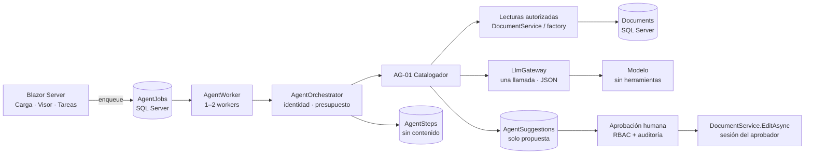

# Multiagentes en DocuSearch AI — análisis profundo y propuesta realista

**Fecha:** 12/11/2026 · **Versión:** 2 (revisada tras dos auditorías independientes) · **Base:** commit `8029295`, `README.md`, `AGENTE-DETALLE.md`, `SECURITY.md`, `LANGFUSE-INTEGRACION.md`, código de `Services/`, `Data/`, `LangChain/` y `tests/`.
**Prerrequisitos:** [`DE-DEMO-A-PRODUCCION.md`](../operacion/DE-DEMO-A-PRODUCCION.md) — qué cerrar antes de la plataforma multiagente.

> **Nota de método.** La primera hipótesis de este análisis era implementar primero el **Agente Catalogador**. El mapa de extensión (`obj/multiagent/extension-map.md`) y la auditoría de riesgo (`obj/multiagent/risk-audit.md`) la corrigieron: el Catalogador resuelve poco de lo que ya existe y su parte nueva es la más sensible. **La recomendación final es el `Agente Verificador (AG-02)` como primera implementación**; el Catalogador queda como segunda fase condicionada a un caso de negocio y a una política de confidencialidad.

---

## 0. Respuesta corta

| Pregunta | Respuesta |
|---|---|
| ¿Se puede implementar multiagentes? | **Sí, pero no como plataforma completa hoy.** El repositorio es una demo local de un proceso, 9 expedientes/89 páginas y 3 usuarios; una cola con leases, aprobaciones y *tool gateway* es sobreingeniería. |
| ¿Cuál es el primer agente que se puede implementar? | **`Agente Verificador` (AG-02).** Determinista, **0 llamadas y 0 tokens**, sin migración, sin UI y sin paquetes nuevos. **Implementado el 13/11/2026** en `Services/AgentVerifier.cs` con 10 comprobaciones (`-- --verifier`). |
| ¿Y un agente con IA (LLM)? | **`Agente Catalogador` (AG-01)**, **MVP opt-in implementado**: una llamada por documento, propuesta sin escritura y consentimiento explícito. La cola/aprobaciones siguen condicionadas. |
| ¿Quién ya existe? | **`Agente Redactor` (AG-04)**: es el asistente actual (`LocalAgent` + `OpenCodeClient`). No se “implementa”, se refactoriza si hace falta. |
| ¿Cuántos agentes valen la pena? | **2 reales** (Verificador + Catalogador condicional) y **2 informes deterministas** (Inspector, Auditor). El resto del catálogo son módulos SQL con nombre de agente. |
| ¿Qué no hacer? | AutoGen/CrewAI/LangGraph, **Pinecone obligatorio** o embeddings remotos (Pinecone opcional ya implementado), OCR simulado, `ToolGateway` con herramientas elegidas por el modelo, agentes que escriben sin aprobación, fan-out de llamadas por consulta. |
| Esfuerzo realista | **Verificador: 1–2 días (hecho).** **Catalogador MVP opt-in: 1 día (hecho).** Plataforma + cola: 2–3 semanas, solo con caso de uso aprobado. |

**El nombre que se puede implementar ya: `Agente Verificador` (AG-02).**
**El nombre del primer agente con LLM, si se justifica después: `Agente Catalogador` (AG-01).**

---

## 1. Por qué esta conclusión (evidencia, no opinión)

1. **El valor ya está cubierto en gran parte.** La carga pide título y categoría al usuario (`UploadDialog`), y la ingesta ya calcula resumen, palabras clave y entidades de forma determinista (`Services/PdfProcessor.cs:83-86`). El Catalogador solo añade una *sugerencia*; su única aportación realmente nueva —proponer confidencialidad— es la decisión más sensible del sistema.
2. **El asistente ya es un agente completo.** `LocalAgent.AskAsync` (`Services/LocalSearch.cs:39`) orquesta recuperación, motor, citas, reautorización y traza; `OpenCodeClient` (`:253-320`) valida el JSON. “Implementar el Redactor” sería renombrar código existente.
3. **La verificación está duplicada y es el hueco real.** La validación de citas vive dentro de cada motor (`OpenCodeClient.cs:397-420`, `OllamaClient.cs:136-138`, rama LangChain `:522-524`) y **solo comprueba IDs contra el lote enviado**: nadie valida que la página exista, que el texto citado esté en ella ni que no haya pares duplicados. Centralizarlo es barato y protege la promesa central del producto.
4. **La infraestructura multiagente no existe y no es barata.** No hay `BackgroundService` ni tablas de trabajos (`Program.cs:46-75`, `Data/AppDbContext.cs:8-13`); la identidad es Scoped y nace de la cookie (`Program.cs:51`, `Services/Permissions.cs:41-48`); el lock global de mutaciones tiene timeout de 15 s (`Data/DatabaseSetup.cs:39-49`). Construir cola, leases, aprobaciones y UI para **un** tipo de trabajo no se paga solo.
5. **El riesgo de seguridad cambia de naturaleza.** Hoy el modelo no tiene herramientas (`OpenCodeClient.cs:438-443`); un `ToolGateway` convertiría una inyección de prompt en una operación real. La mayor fortaleza del producto es que el modelo **no puede actuar**.
6. **Privacidad en segundo plano.** Con proveedor remoto, los fragmentos ya salen del equipo cuando el usuario consulta (`SECURITY.md:71-73`). Un Catalogador automático enviaría documentos **sin usuario delante**, incluidos confidenciales, si no se restringe por nivel.
7. **Aprobaciones con 3 usuarios y 1 administrador.** La segregación de funciones real es imposible (`appsettings.json:17-36`); una aprobación de escritura sería ceremonia, no control. Hay que declararlo, no simularlo.
8. **Coste/latencia.** La consulta actual ya puede tardar hasta ~225 s en el peor caso antes del fallback (3 intentos × 75 s + backoff: `appsettings.json:56-63`, `AgentResilience.cs:61-89`). Añadir pasos o llamadas empeora la experiencia sin mejorar la respuesta.

---

## 2. Línea base verificada (y correcciones importantes)

Antes de dimensionar cualquier multiagente hay que cerrar estas inconsistencias:

| Tema | Dato real | Implicación |
|---|---|---|
| Pruebas | **87** incondicionales; `--database` añade **12** (99); `--database --langchain` = **102**; `--langchain-opencode` = **88**; `--opencode` añade **3** | El README dice “once” en un punto y “dos” en otro; el código es la verdad. Cualquier entrega debe conservar 87/102/88 y añadir checks. |
| Motor activo | El `appsettings.json` versionado apunta a un modelo gratis; la instancia documentada usa `paid:deepseek/deepseek-flash` porque la cuota gratis se agotó | Cualquier presupuesto debe asumir **pago** o degradación, no cuota gratis. |
| Cuota gratis | `GenerateFreeAsync` (`OpenCodeClient.cs:327`) **no se invoca en ningún sitio**; el manejo de `FreeQuotaExceededException` es código muerto | Un fan-out de agentes multiplicaría fallos sin la protección prevista. Arreglar antes de Fase 1. |
| Resiliencia | `AgentResilience` solo envuelve **OpenCode** (`:258`), no Ollama | El Verificador cubre ambos motores; el Catalogador usa el motor activo con opt-in y `AgentResilience` solo en OpenCode. |
| Esquema de trazas | `AgentTrace` tiene una lista exacta de propiedades que una prueba fija (`tests/Program.cs:434-437`) | **No ampliar `AgentTrace`**; crear `AgentSteps` aparte si se llega a Fase 1. |
| Lectura de documentos | `DocumentService.LoadAsync` carga **todos** los legibles (`:56-64`); `ViewAsync` audita y suma vistas (`:87-97`); no hay lectura por id “limpia” | Un agente por job no debe llamar `LoadAsync`; hace falta un método de lectura por id sin efectos o usar el `IDbContextFactory`. |
| Auditoría | No existe `AuditService`: el método `Audit` es privado (`DocumentService.cs:28-33`) y `LogQueryAsync` solo acepta `SEARCH`/`AGENT_QUERY` (`:305-312`) | Habría que añadir un método de auditoría para eventos de agentes. |
| Estado del proveedor | `freeQuotaUntil`, `toolIds` y `serverKind` son campos de instancia (`OpenCodeClient.cs:43-48`); `AssistantRuntime` es singleton y captura un cliente transitorio | Con varios workers se fragmenta la cuota; centralizar en un `LlmGateway` singleton o en un guardián de cuota. |
| Lock de mutaciones | `sp_getapplock` exclusivo, recurso `DocuSearch.DocumentMutations`, timeout 15 s (`DatabaseSetup.cs:39-49`) | Nunca retenerlo durante una llamada al modelo (75 s+); no usarlo para reclamar jobs. |
| Timeouts | Intento 75 s < OpenCode 120 s < Ollama 240 s; el proceso Python **no recibe `CancellationToken`** (`LangChainRunner.cs:13`) | Un job puede seguir corriendo aunque el timeout del intento se haya disparado. |

---

## 3. Qué es un “agente” aquí

Un agente es un rol con (a) contrato de entrada/salida validable, (b) operaciones cerradas y autorizadas, (c) presupuesto, (d) trazas sin contenido y (e) fallback determinista. **El LLM es opcional.** La regla del producto se mantiene: **el modelo propone; C# verifica, autoriza y ejecuta**.

| Tipo | LLM | Escribe | Ejemplo |
|---|---|---|---|
| Determinista | No | No | Verificador, Inspector |
| Asistido | 1 llamada | No (propone) | Catalogador (fase 2) |
| Con aprobación | Sí | Solo tras aprobación humana | Migrador (fase 4) |

Patrones permitidos: cadena explícita, verificador, router y humano-en-el-bucle. Prohibido: enjambre autónomo, *tool calling* libre y bucles sin presupuesto.

---

## 4. Primera entrega: `Agente Verificador` (AG-02)

### 4.1 Qué es

Un agente **determinista** que revisa la salida del motor antes de mostrarla o de aceptar una propuesta. No usa LLM, no llama a HTTP, no escribe contenido y no necesita cola ni migración. Se integra en el camino actual de la consulta y, más adelante, en cualquier agente nuevo.

### 4.2 Qué valida

1. Respuesta no vacía y ≤ 10 000 caracteres.
2. Al menos una cita; IDs enteros dentro de `1..N`; sin duplicados (normalizados).
3. La página citada existe en el documento (`DocumentItem.Pages`).
4. La fuente citada es legible por el actor actual (reutiliza `Permissions`).
5. Sin par documento+página repetido.
6. En modo extendido: coincidencia del texto citado con la página (sin inventar) y detección de documentos duplicados por SHA-256.
7. Códigos de error cerrados, sin texto de la respuesta ni del fragmento.

### 4.3 Contrato propuesto

```csharp
public enum VerificationCode
{
    Ok, Empty, TooLong, NoCitations, BadCitation, DuplicateCitation,
    PageMissing, UnauthorizedSource, DuplicatePair, TextNotInPage, DuplicateDocument
}

public sealed record VerificationIssue(VerificationCode Code, int? Citation, string? DocumentCode, int? Page);
public sealed record VerificationResult(bool IsValid, IReadOnlyList<VerificationIssue> Issues);

public interface IAgentVerifier
{
    VerificationResult Verify(AgentAnswer answer, IReadOnlyList<DocumentItem> readableDocuments, AppUser actor);
}
```

- Se invoca **después** de `ParseAnswer` (`OpenCodeClient.cs:397-420`) y del equivalente de Ollama, y **antes** de devolver la respuesta.
- Si falla: se bloquea la respuesta generada y se usa el fallback extractivo, como hoy (`LocalSearch.cs:95-117`). El comportamiento visible no cambia; cambia la garantía.
- En la rama LangChain, el verificador se aplica sobre el JSON ya parseado; no toca Python.

### 4.4 Por qué es el primero

- **Coste 0:** sin LLM, sin tokens, sin cuota.
- **Latencia:** p95 ≤ 10 ms con 6 fuentes (medible con `Stopwatch` en la prueba).
- **Sin infraestructura:** no requiere cola, worker, migración, UI ni paquetes nuevos.
- **Reduce divergencia:** una sola implementación para OpenCode, Ollama y LangChain, en lugar de tres validaciones parciales.
- **Es la puerta de cualquier agente futuro:** sin verificador no debería existir un Catalogador que proponga metadatos.
- **Se prueba con la suite actual:** `TestHttpHandler` y `TestFactory` ya permiten simular motores (`tests/Program.cs:82-112`, `:1059-1069`).

### 4.5 Criterios de aceptación (AG-02 v1)

- [ ] C# puro, sin HTTP, sin LLM, sin escrituras; invocado por **ambos** motores antes de mostrar respuesta.
- [ ] Verifica longitud, citas 1..N, duplicados, página existente, fuente legible y par documento+página único.
- [ ] Devuelve códigos enumerados; ningún mensaje incluye texto de la respuesta o del fragmento.
- [ ] 0 llamadas y 0 tokens; p95 ≤ 10 ms con 6 fuentes.
- [ ] Se conservan **87/87**, **102/102** y **88/88**; se añaden ≥ 8 checks deterministas sin red.
- [ ] Sin migración, sin paquete NuGet nuevo, sin cambios en RBAC, autenticación, auditoría ni esquema de trazas.
- [ ] Ante respuesta inválida, el comportamiento es idéntico al actual: bloquear y usar extractivo.
- [ ] Informe de duplicados: detecta un fixture con el mismo SHA-256; 0 falsos positivos en los documentos de la instancia.
- [ ] Documentación mínima en `README.md`/`AGENTE-DETALLE.md` con alcance y límites.

**Pruebas mínimas:** respuesta válida; vacía; > 10 000; cita `0`; cita `N+1`; cita duplicada; página inexistente; fuente no autorizada; par duplicado; documento con SHA repetido; página sin texto. Todas sin modelo y sin base real.

**Esfuerzo:** 1–2 días incluyendo pruebas y documentación. **Riesgo:** casi nulo; no cambia el modelo ni los permisos.

### 4.6 Implementación (13/11/2026)

- `Services/AgentVerifier.cs`: códigos cerrados, `TryNormalizeCitations`, `Verify` y `FindDuplicateDocuments`.
- Integrado en el parseo de OpenCode directo, LangChain y Ollama para centralizar la normalización de citas; la verificación semántica (documento autorizado, página, par duplicado, texto en página/resumen) se ejecuta en `LocalAgent` antes de mostrar la respuesta y bloquea con fallback extractivo.
- 10 comprobaciones deterministas con `--verifier`: 97/97 en total, 0 tokens, sin migración ni paquetes nuevos.
- **AG-10 Inspector implementado (13/11/2026):** `Services/DocumentInspector.cs` + módulo `/quality` (solo administración general y auditoría); informe de OCR pendiente, originales ausentes, metadatos incompletos, duplicados SHA-256 e integridad verificable. 5 comprobaciones con `--inspector` (92/92 en total). Sin LLM, sin escritura, sin migración.
- **AG-01 Catalogador MVP implementado (13/11/2026):** `Services/CatalogSuggester.cs` + botón **Sugerir ficha** en el formulario de metadatos. Una llamada, consentimiento explícito, propuesta sin escritura, bloqueo de confidenciales con motor remoto y verificación AG-02. 5 comprobaciones con `--catalog` (92/92 en total). Sin cola, sin migración.
- **AG-10 ampliado y AG-06 implementados (15/11/2026):** `Services/RagIndexInspector.cs` añade la salud del índice RAG a `/quality` (con reindexado auditado solo para administración general); `Services/Rag/RagObservatory.cs` añade la calidad del asistente a `/observability`. `RagQueryService` registra ahora trazas `rag-*` y respeta `Rag:AuditContent` (sin él, la bitácora guarda solo un hash de la pregunta). 7 comprobaciones nuevas en `--inspector` y 7 en `--rag`. Sin LLM ni migración.
- **AG-05 Auditor implementado (13/11/2026):** `Services/AuditInspector.cs` + panel de riesgos en Auditoría; intentos fallidos, accesos denegados, integridad, cambios administrativos, descargas y acciones frecuentes. 5 comprobaciones con `--audit` (92/92 en total). Sin LLM, sin escritura.

---

## 5. Segunda fase (condicional): plataforma + `Agente Catalogador` (AG-01)

> **Estado (13/11/2026):** se implementó el **MVP sin plataforma**: `Services/CatalogSuggester.cs` y el botón **Sugerir ficha** en el formulario de metadatos. Es opt-in, hace una sola llamada, no escribe nada, exige consentimiento explícito, bloquea confidenciales con motor remoto y aplica AG-02 antes de mostrar la propuesta. Queda pendiente la cola persistente, las aprobaciones formales y `AgentJobs/AgentSteps` si hay caso de negocio y política aprobada.

> **No empezar aquí.** Esta fase solo se justifica si hay volumen real (lotes de hasta 20 PDF), metadatos inconsistentes y una decisión explícita sobre confidencialidad y proveedor. Si no, el Verificador es suficiente.

### 5.1 Condiciones previas

1. **Caso de negocio medido:** tiempo actual de catalogación y tasa de error; sin eso, no hay retorno.
2. **Política de confidencialidad:** `Confidencial` y `Estrictamente Secreto` **nunca** a proveedor remoto; solo local/extractivo, o no se catalogan automáticamente.
3. **Opt-in por carga:** el usuario elige “catalogar con IA”; no se envía nada por defecto.
4. **Una llamada por documento**, con 4–6 fragmentos de 1 000 caracteres; nunca el PDF completo.
5. **Aprobación humana** para aplicar cualquier campo; la confidencialidad **no se rebaja automáticamente**.
6. **Verificador ya implementado** como puerta de calidad.

### 5.2 Arquitectura mínima (si se aprueba)



- `AgentJobs`: cola con `Status`, `Attempts`, `LeaseUntil`, `NotBeforeUtc`, `IdempotencyKey`, `ActorUserId`.
- `AgentSteps`: una fila por paso, sin contenido (solo código, duración, estado, tokens).
- `AgentSuggestions`: propuesta + evidencia + estado; **nunca** escritura directa sobre `Documents`.
- **No ampliar `AgentTrace`** (rompe la prueba de propiedades): `AgentSteps` es la tabla nueva.
- Reclamo atómico con `UPDATE TOP(1) ... WITH (ROWLOCK, UPDLOCK, READPAST)`; **nunca** el `sp_getapplock` global (`DocuSearch.DocumentMutations`).
- 1–2 workers; `MaxConcurrentAgents` en configuración; parada y `dead-letter` tras 3 intentos.
- Identidad: el job guarda `ActorUserId`; el worker crea un scope, relee el usuario, exige `Status == "Activo"`, fija `LocalSession` (setter `internal`, `Permissions.cs:35`) y revalida el rol. Nunca un rol “congelado” ni una identidad propia del agente.
- El `AgentOrchestrator` es **Scoped** (o Singleton solo con `IDbContextFactory`); el worker usa `IServiceScopeFactory`. No capturar servicios Scoped.
- Circuit breaker con claves separadas (`agent.catalog`, no `opencode.generate`) para no abrir el circuito de la UI.
- Presupuesto persistente; parada de trabajos de fondo al 80 % del cupo diario.

### 5.3 Flujo del Catalogador

```text
1. PostUpload → Enqueue("catalog", docId, actorUserId)  (opt-in)
2. Worker: claim → scope → usuario actual (activo, rol revalidado)
3. Lecturas autorizadas: metadatos, 4–6 fragmentos, resumen y entidades existentes, catálogo
4. LlmGateway: prompt + fuentes → JSON (1 llamada, 1 500 in / 500 out)
5. Verificador: esquema, categoría, nivel, evidencia, páginas, duplicados
6. AgentSuggestions: pending, TTL 72 h, confidencialidad del documento
7. UI: diff + evidencia; aprobar/rechazar
8. Aprobación con CanWrite y revalidación de SHA/versión del documento
9. EditAsync con la sesión del aprobador + auditoría AGENT_SUGGESTION_APPROVED/REJECTED
```

### 5.4 Contrato del Catalogador

```json
{
  "title": "Contrato de servicios 2026",
  "category": "Contratos",
  "department": "Tecnología & TI",
  "confidentiality": "Confidencial",
  "keywords": ["SLA", "mantenimiento", "penalizaciones"],
  "summary": "Contrato con disponibilidad del 99.99 % y tiempos de respuesta por criticidad.",
  "confidence": 0.82,
  "evidence": [
    { "source_id": 1, "page": 2, "claim": "SLA 99.99 %" }
  ]
}
```

Reglas: categoría y departamento contra catálogo; confidencialidad contra los 4 niveles; `keywords` ≤ 10; `summary` ≤ 1 200 caracteres; cada `source_id` debe existir; cada página debe existir; `confidence` ∈ [0,1]; si < 0,5 se marca “baja confianza” y no se precarga nada. Si el modelo falla: propuesta solo determinista (título, resumen extractivo, entidades) marcada `rules`; sin categoría ni confidencialidad.

### 5.5 Criterios de aceptación (si se implementa)

- [ ] Con opt-in, cargar un PDF crea un job en ≤ 1 s y una sugerencia `pending` sin modificar el documento.
- [ ] Aprobar aplica los campos con `EditAsync` y audita; rechazar no cambia nada.
- [ ] JSON inválido o evidencia inventada **no** genera sugerencia aprobable.
- [ ] Un consultor no puede encolar; un usuario sin `CanWrite` no puede aprobar.
- [ ] Reejecutar no duplica sugerencias (idempotencia).
- [ ] Reiniciar a mitad no pierde la tarea (lease vencido → reintento).
- [ ] Documentos confidenciales no se envían a proveedor remoto.
- [ ] 87/102/88 siguen pasando y se añaden ≥ 20 checks nuevos.

**Esfuerzo:** plataforma 8–10 días + agente 8–10 días (medio tiempo). **Riesgo:** medio-alto (identidad, aprobaciones, privacidad).

---

## 6. Catálogo de agentes: qué implementar, qué no

| Código | Nombre | Tipo | LLM | Disposición | Motivo |
|---|---|---|---|---|---|
| **AG-02** | **Verificador** | Determinista | No | **Implementar ya** | 0 tokens, cierra un hueco real, sin migración. |
| AG-04 | Redactor | Asistido | Sí | **Ya existe** | `LocalAgent` + `OpenCodeClient`; solo refactor si se integra el verificador. |
| **AG-01** | **Catalogador** | Asistido | Sí | **MVP opt-in implementado** | Sugerencia manual en el formulario; sin escritura, con consentimiento y bloqueo de confidenciales con motor remoto. Cola/aprobaciones pendientes. |
| AG-10 | Inspector | Determinista | No | **Implementado (informe)** | Informe de OCR pendiente, originales, metadatos, duplicados e integridad; sin LLM ni escritura. |
| AG-05 | Auditor | Determinista | No | **Implementado (informe)** | Resumen de riesgos en la página de Auditoría: intentos fallidos, accesos denegados, integridad, cambios administrativos y descargas; sin LLM. |
| AG-06 | Observador | Determinista | No | **Implementado (informe RAG)** | Calidad del asistente en `/observability` a partir de `RAG_QUERY`: cobertura, confianza, rechazos AG-02, fallos del motor, latencia y preguntas sin respuesta fiable. |
| AG-03 | Recuperador | Determinista | Opcional | **Cubierto por el pipeline RAG** | Recuperación híbrida por fragmentos, reranking y verificación en `Services/Rag`; no requiere un agente aparte. |
| AG-07 | Archivista | Determinista | No | Posponer | No hay campos de retención ni política aprobada. |
| AG-08 | Migrador | Determinista | Opcional | Posponer | `LegacyImport` y el hash ya resuelven; solo si la migración se repite. |
| AG-09 | Guía | Asistido | Sí | **Descartar** | Ayuda estática; un LLM que explique la app alucina y cuesta. |

**Aclaración de nombres:** el catálogo tiene 10 nombres posibles, pero **solo 2 son implementables con valor** (Verificador y Catalogador condicional), **1 ya existe** (Redactor) y **4 son informes deterministas** que no deberían llamarse agentes. Esto es lo realista: no hay 10 agentes esperando.

---

## 7. Procesos de la app → agentes

| Proceso | Hoy | Agente | Decisión realista |
|---|---|---|---|
| Acceso TOTP y RBAC | Cookie + TOTP + permisos | — | No necesita agente. |
| Carga de PDF | `UploadDialog` + `DocumentService.UploadAsync` | AG-01 (opt-in) | Implementado como sugerencia manual en metadatos; sin escritura ni envío por defecto. |
| Ingesta | PdfPig, resumen, entidades, `OcrStatus` | AG-10 | Implementado como informe determinista; no OCR. |
| Búsqueda | `LocalSearch` léxica | AG-03 | No tocar; medir antes. |
| Asistente | `LocalAgent` + `OpenCodeClient` | AG-02 + AG-04 | Verificador primero; el Redactor se mantiene. |
| Visor/notas | Humano | — | No delegar escritura. |
| Reportes | CSV/HTML deterministas | — | No convertir en agente. |
| Auditoría | Bitácora + CSV | AG-05 | Implementado como resumen de riesgos determinista en la propia bitácora; sin LLM. |
| Observabilidad | Panel de 500 trazas + calidad del asistente RAG | AG-06 | Implementado como métricas deterministas sobre la bitácora (15/11/2026). |
| Administración/migración | `LegacyImport` | AG-08 | Posponer. |
| Retención | Manual | AG-07 | Requiere política; no ahora. |
| Ayuda | Documentación | AG-09 | Descartar. |

---

## 8. Coste, latencia y cuotas

| Tarea | Llamadas | Entrada | Salida | Latencia | Degradación |
|---|---|---|---|---|---|
| Consulta actual (AG-04) | 1 (hasta 3 intentos) | ~2,5–3 k tokens | ~0,3–0,6 k | 2–12 s típica; peor ~225 s | Extractivo con aviso |
| AG-02 Verificador | 0 | 0 | 0 | p95 ≤ 10 ms | No aplica |
| AG-01 (si se aprueba) | 1/doc | ≤ 1,5 k | ≤ 0,5 k | ≤ 30 s/doc | “Pendiente de catalogación” |
| Lote de 20 PDF con AG-01 | ≤ 20 | ≤ 40 k | ≤ 12 k | ~10 min | Pausar cola |
| Auditoría/observabilidad/calidad | 0 | 0 | 0 | ≤ 1 s | SQL directo |
| Presupuesto diario global | ≤ 150 | ≤ 300 k | ≤ 60 k | — | Parar trabajos de fondo al 80 % |

Reglas: (1) lo determinista siempre funciona sin modelo; (2) modelo local antes que remoto; (3) el de pago solo dentro del presupuesto; (4) **nunca** cambiar de proveedor automáticamente; (5) cuota agotada o circuito abierto → primero se detienen los trabajos de fondo, luego la consulta cae a extractivo; (6) el presupuesto se persiste, no en memoria.

**Coste real:** no se pueden dar dólares fiables sin tarifa versionada; la fórmula es `tokens × tarifa vigente`. El volumen estimado (100 consultas/día + 20 PDF catalogados) ronda **280 k tokens de entrada y 40 k de salida al día**. Un Catalogador con varias llamadas por documento lo multiplica por 5–10; por eso el límite es **una llamada por documento**.

---

## 9. Seguridad y privacidad

| # | Riesgo | Control |
|---|---|---|
| 1 | Inyección que induce una operación | **No construir `ToolGateway` ahora.** Si algún día existe, la operación la elige el servidor, no el modelo; el modelo solo devuelve JSON sin efectos. |
| 2 | Desclasificación por inyección (“clasifícame como Público”) | La sugerencia no se aplica sola; aprobación de `admin_general`; mostrar justificación; el RBAC sigue usando la clasificación vigente. |
| 3 | Exfiltración masiva a proveedor remoto | Documentos `Confidencial`/`Estrictamente Secreto` nunca a remoto; opt-in; solo fragmentos; presupuesto y auditoría. |
| 4 | Suplantación del actor | `ActorUserId` desde el contexto autenticado; resolver de nuevo en BD; rechazar inactivo/rol cambiado. Sin identidad propia para agentes. |
| 5 | TOCTOU al aprobar | Vincular aprobación a `documentId` + SHA-256/versión; revalidar al aplicar. |
| 6 | IDOR sobre jobs/sugerencias | IDs no adivinables y autorización por actor en cada lectura, no solo en la UI. |
| 7 | Contenido en trazas/pasos | Esquema cerrado; `AgentSteps` solo códigos, duración y tokens; sin prompts ni fragmentos. |
| 8 | Repetición/duplicados | Clave de idempotencia única y transición de estado con comparación y cambio. |
| 9 | DoS de cola | Cuota por usuario, tope de cola, rate limit, circuit breaker. |
| 10 | Aprobación robada | Reautenticación TOTP para aprobar (si el riesgo lo exige), expiración corta, antiforgery ya activo. |
| 11 | XSS desde salida del modelo | Razor escapa; nunca `MarkupString` en informes. |
| 12 | Secretos | Sin credenciales en payloads, trazas ni modelo. |

**Aprobaciones:** solo para escrituras reales; con 3 usuarios y 1 administrador, la segregación de funciones es imposible. Hay que declararlo en la documentación; no simular un control que no existe.

**Aislamiento del modelo:** se mantienen los permisos `deny` (`OpenCodeClient.cs:442`), loopback (`SECURITY.md:64-75`), sesión por consulta eliminada al final y Langfuse desactivado por defecto.

---

## 10. Observabilidad y evaluación

- **AG-02:** no necesita tabla nueva. Sus resultados se prueban con la suite; en producción se puede registrar un contador de bloqueos en la traza existente (sin contenido) o en un log de categoría.
- **Fase 2:** `AgentSteps` por paso; panel en `/observability` con jobs por estado, p50/p95, tokens por agente, fallbacks y sugerencias pendientes/aprobadas/rechazadas.
- **No** guardar pregunta, respuesta, fragmentos ni identidad; mantener la promesa actual.
- Langfuse sigue opcional y solo metadatos; correlación con `job_id` si se llega a Fase 2.
- **Golden set:** 20–30 preguntas y 10 documentos con respuesta y página esperadas; medir precisión de citas, JSON válido, latencia y tasa de aprobación. Sin esto, el multiagente no es evaluable.

---

## 11. Plan realista

| Fase | Entregable | Esfuerzo | Puerta |
|---|---|---|---|
| **0** | **AG-02 Verificador** + integración en ambos motores + pruebas | **Hecho (13/11/2026)** | 87/87 base y 97/97 con `--verifier`; 0 tokens. |
| 1 (condicional) | Caso de negocio, política de confidencialidad, opt-in, golden set | 2–3 días de análisis | Decisión del dueño. |
| 2 (condicional) | Plataforma mínima (`AgentJobs`, `AgentSteps`, `AgentSuggestions`, worker, identidad) | 8–10 días | Job sobrevive reinicio; RBAC revalidado. |
| 3 (condicional) | AG-01 Catalogador + aprobación + UI | MVP opt-in **hecho**; cola/aprobaciones 8–10 días | Criterios §5.5; no exfiltración. |
| 4 (opcional) | Informes deterministas: Inspector (**hecho**), Auditor (**hecho**) | 3–5 días | Sin LLM, sin contenido. |

**MVP realista:** Fase 0. Si el dueño aprueba el caso de uso, Fases 2–3 en **2–3 semanas** más. Si solo se quiere una demo de “agente que cataloga”, se puede hacer un prototipo sin cola en 3–5 días, pero **no** debe presentarse como producción.

**Rollback:** AG-02 no requiere migración; si algo falla, se revierte el cambio de llamada. Fases 2–3: feature flag `Agents:Enabled=false` y migración aditiva.

---

## 12. Decisiones que requieren al dueño del producto

1. ¿Hay volumen real (lotes, metadatos inconsistentes) que justifique el Catalogador?
2. ¿Se permite enviar fragmentos a un proveedor remoto en segundo plano? ¿Solo documentos ≤ Uso Interno?
3. ¿Quién aprueba: gestor, admin de departamento o admin general?
4. ¿El Catalogador puede proponer confidencialidad o solo título/categoría/palabras clave?
5. ¿TTL de sugerencias: 24 h, 72 h?
6. ¿Se invierte en OCR real o el Inspector solo deriva a revisión humana?

---

## 13. Qué no hacer

- No `ToolGateway` ni herramientas elegidas por el modelo: hoy el modelo no puede actuar y esa es su mayor defensa.
- No AutoGen/CrewAI/LangGraph/Semantic Kernel: autonomía, dependencias y modos de fallo no justificados.
- **Embeddings locales implementados (14/11/2026):** `bge-m3` (1024 dims) por página en `PageEmbeddings`, búsqueda híbrida léxica + coseno, índice al cargar/editar/reprocesar y backfill `--reindex-embeddings`. **Pinecone es opcional** para sincronizar y consultar el mismo vector; no es una dependencia obligatoria y no recibe texto. El fallback léxico se mantiene si Ollama no responde.
- No OCR simulado: `PdfPig` solo lee capa de texto; el OCR es un proyecto aparte.
- No RAG de documento completo ni map-reduce: 20 PDF × 5 M caracteres sería inviable (~25 M tokens).
- No debate/votación entre agentes: multiplica llamadas y no es evaluable.
- No cola para todo ni Hangfire ahora: un tipo de trabajo no justifica un framework.
- No aprobaciones para propuestas de solo lectura: solo para escrituras.
- No autoaplicar clasificación, retención ni deduplicación.
- No guardar contenido en trazas, pasos, logs, auditoría ni Langfuse.
- No cambiar de proveedor automáticamente ni usar gratis como fallback.
- No exponer la app fuera de loopback ni afirmar TLS/identidad de producción.

---

## Anexo A — Evidencia y auditorías

- `obj/multiagent/extension-map.md` — mapa de extensión, firmas, líneas, esquema, pruebas (260 líneas, solo lectura).
- `obj/multiagent/risk-audit.md` — auditoría de realismo, seguridad, costes y veredicto (184 líneas, solo lectura).
- Documentación base: `README.md`, `AGENTE-DETALLE.md`, `SECURITY.md`, `LANGFUSE-INTEGRACION.md`.
- Código clave: `Services/LocalSearch.cs`, `Services/OpenCodeClient.cs`, `Services/OllamaClient.cs`, `Services/AgentResilience.cs`, `Services/AgentObservability.cs`, `Services/DocumentService.cs`, `Services/Permissions.cs`, `Data/AppDbContext.cs`, `Program.cs`, `tests/Program.cs`.

## Anexo B — Resumen de decisiones

| Decisión | Recomendación |
|---|---|
| ¿Multiagente completo? | No ahora; solo el Verificador. |
| Primer agente | **Agente Verificador (AG-02)**. |
| Primer agente con LLM | **Agente Catalogador (AG-01)**, MVP opt-in implementado; cola/aprobaciones condicionadas. |
| Redactor | Ya existe; no reimplementar. |
| Cola/plataforma | Solo si se aprueba AG-01; propia en SQL Server. |
| Herramientas del modelo | Ninguna. |
| Aprobaciones | Solo para escrituras; declarar límite de segregación. |
| Presupuesto | 1 llamada por documento; 300 k tokens/día; parada al 80 %. |
| Trazas | `AgentSteps` sin contenido; no tocar `AgentTrace`. |
| Esfuerzo inmediato | 1–2 días (Verificador). |
